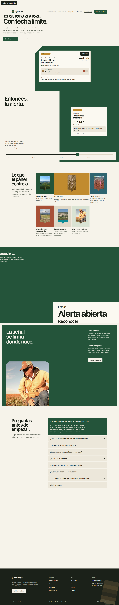
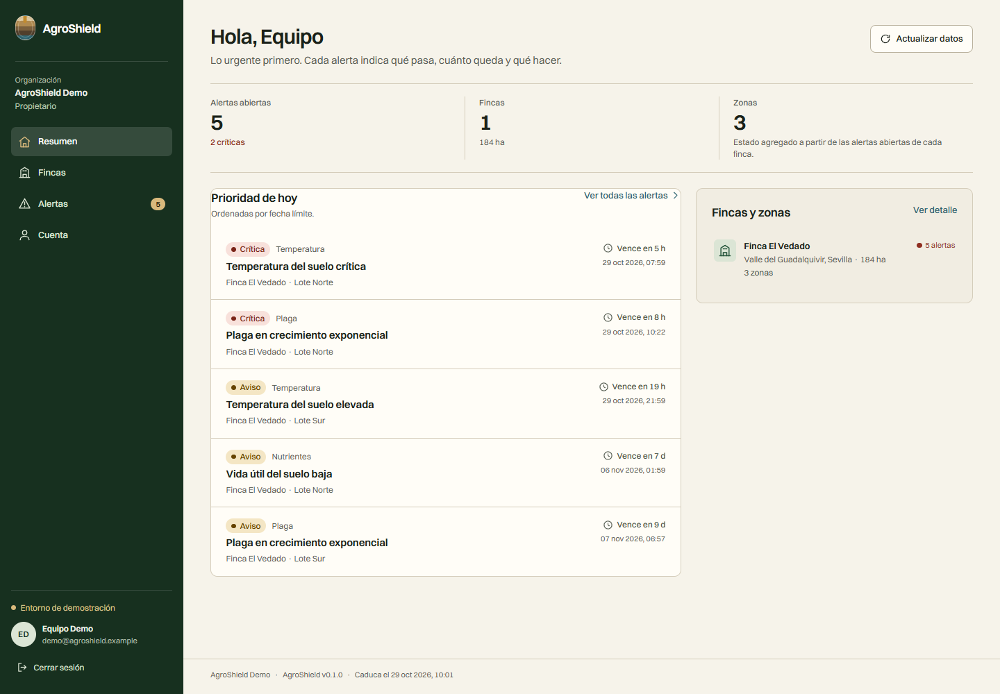

# AgroShield

[](https://github.com/Zatrynox/agroshield/actions/workflows/ci.yml)
[](https://nodejs.org/)
[](docs/status/PENDING.md)

AgroShield convierte lecturas de suelo firmadas por sensores en alertas con cuenta atrás y recomendaciones operativas. El objetivo es que una explotación agrícola sepa **qué zona está en riesgo, cuánto queda y qué hacer ahora** sin interpretar una tabla de sensores en bruto.

| Landing | Panel |
| --- | --- |
|  |  |

> **Estado:** entrega funcional `0.1.0` para demo local y revisión. No es un despliegue de producción. El stack Docker local y CI están verificados (4/4 jobs en verde el 2026-10-31); antes de publicar hay que completar la identidad legal, la infraestructura de producción y los canales de contacto descritos en [`docs/launch-checklist.md`](docs/launch-checklist.md).

## Repositorios

El monorepo es la fuente de verdad. Cada superficie se publica también como repositorio independiente, con CI propia y las piezas compartidas necesarias para compilar por separado.

| Repositorio | Contenido | Verificación |
| --- | --- | --- |
| [`agroshield`](https://github.com/Zatrynox/agroshield) | Monorepo completo, Compose, QA y documentación | CI 4/4 |
| [`agroshield-backend`](https://github.com/Zatrynox/agroshield-backend) | API Fastify, dominios, migraciones, seed y simulador | Typecheck, lint, 41 tests, build, Docker |
| [`agroshield-frontend`](https://github.com/Zatrynox/agroshield-frontend) | Panel Vue 3 + Vite + Pinia + Router | Typecheck, 13 tests, build |
| [`agroshield-landing`](https://github.com/Zatrynox/agroshield-landing) | Sitio público Astro, demo, legal y SEO | Typecheck, 23 tests, build |
| [`agroshield-design-tokens`](https://github.com/Zatrynox/agroshield-design-tokens) | Tokens CSS, tipografía y utilidades visuales | Typecheck |
| [`agroshield-infra`](https://github.com/Zatrynox/agroshield-infra) | Dockerfiles, Compose y Caddy | Validación estática, Compose y Caddy |
| [`agroshield-docs`](https://github.com/Zatrynox/agroshield-docs) | Diseño, QA, checklist y estado | Enlaces relativos |

## Qué incluye esta entrega

- API Node.js + TypeScript estricto con Fastify, Zod, PostgreSQL, migraciones versionadas, Problem Details, OpenAPI y buses CQRS.
- Contextos implementados: `iam`, `organizations`, `farms`, `sensors`, `alerts`, `soil-health`, `forecast`, `predictions`, además de `leads` y `analytics`.
- Autenticación con Argon2id, cookie de sesión HttpOnly, CSRF, bloqueo por intentos fallidos, RBAC y aislamiento por organización.
- Sensores con claves Ed25519: la clave privada se entrega una sola vez, las lecturas se firman, se pueden rotar y revocar, y la ingesta es idempotente.
- Aplicación Vue 3 + Vite + Pinia + Vue Router con login, registro, panel protegido, fincas, zonas, alertas, cuenta, estados de carga/error/vacío/offline y sesión caducada.
- Sitio público Astro con landing, demo, gracias, legal, créditos, 404, sitemap, robots, JSON-LD, consentimiento de analítica y formulario con honeypot + captcha de prueba de trabajo.
- Tokens de diseño compartidos en `packages/design-tokens`, consumidos por la aplicación y la landing.
- Infraestructura Docker de desarrollo, local y producción con imágenes no-root, healthchecks, redes privadas, Caddy como único origen, HTTPS en producción, Trivy y Gitleaks. El stack local, las imágenes y los escaneos se ejecutaron y verificaron en esta máquina.
- 77 pruebas automatizadas (41 backend, 13 frontend, 23 landing), 39 comprobaciones de UI, 23 comprobaciones de API en vivo y 0 violaciones de axe en las pantallas auditadas.

## Estructura del monorepo

```text
AgroShield/
├── backend/                  API Fastify, dominios, migraciones, seed y simulador
├── frontend/                 Aplicación Vue del panel
├── landing/                  Sitio público Astro
├── packages/design-tokens/   Variables CSS y utilidades visuales compartidas
├── infra/
│   ├── docker/               Dockerfiles y Caddyfiles
│   └── env/                  Ejemplo de entorno de producción
├── scripts/                  QA de UI, smoke de API, enlaces, infraestructura y stack
├── docs/                     Diseño, QA, checklist de lanzamiento y estado pendiente
├── compose.yaml              Stack local autocontenido (HTTP, puerto 8080)
├── compose.dev.yaml          Stack de desarrollo con hot reload
├── compose.prod.yaml         Stack de producción (HTTPS, puerto 443)
├── Makefile                  Atajos equivalentes a los scripts de pnpm
└── PRODUCT.md                Contexto de producto y restricciones
```

## Inicio rápido en el host

### Requisitos

- Node.js `>= 22` (probado con `24.15.0`).
- pnpm `11.1.2` (`corepack enable` o `npm i -g pnpm@11.1.2`).
- Chrome instalado para los scripts de QA con Playwright (`channel: 'chrome'`).
- Docker Desktop solo si vas a usar los stacks de Compose.

### 1. Configurar el entorno

```bash
cp .env.example .env
cp landing/.env.example landing/.env
# opcional: cp frontend/.env.example frontend/.env
```

Los valores de `.env.example` son ficticios y locales. No los reutilices en producción. El backend rechaza secretos de ejemplo, cookies inseguras, CORS HTTP, `DEMO_MODE=true` y `TRUST_PROXY=false` cuando `NODE_ENV=production`.

### 2. Instalar dependencias

```bash
pnpm install --frozen-lockfile
```

En un entorno no interactivo, pnpm puede pedir confirmación para purgar `node_modules`; usa `CI=true pnpm install --frozen-lockfile --prod=false`.

### 3. Arrancar las tres superficies

En tres terminales:

```bash
pnpm dev:api       # http://localhost:3000
pnpm dev:app       # http://localhost:5173
pnpm dev:landing   # http://localhost:4321
```

El frontend y la landing usan un proxy same-origin `/api` hacia el backend, de modo que la cookie de sesión y el token CSRF no cruzan orígenes.

### 4. Sembrar la demo

Con la base PGlite del host, detén temporalmente la API antes de sembrar para evitar lecturas obsoletas entre procesos, y vuelve a arrancarla después:

```bash
# Ctrl+C en la terminal de pnpm dev:api
pnpm seed
pnpm dev:api
```

La salida del seed indica el correo y recuerda que la contraseña es el valor de `DEMO_PASSWORD` de tu `.env`. En el ejemplo local es `Demo-AgroShield-2026!`; cámbialo si vas a compartir el entorno.

Credenciales de ejemplo:

```text
Correo:    demo@agroshield.example
Contraseña: valor de DEMO_PASSWORD (ejemplo: Demo-AgroShield-2026!)
```

El seed es deliberadamente destructivo con la organización `agroshield-demo`: la elimina y la recrea. No lo ejecutes contra una base con datos reales.

### 5. Simular lecturas firmadas (opcional)

```bash
pnpm simulate
```

El simulador usa las claves privadas locales creadas por el seed en `backend/.data/demo-keys/` (ignoradas por git). Nunca se publican claves privadas reales.

## Docker

### Stack local autocontenido

Un solo origen en `http://localhost:8080` (o el puerto que publiques):

- `/` landing
- `/app` panel Vue
- `/api` API (el prefijo se elimina al proxyar)
- `/docs` Swagger UI, solo local

```bash
docker run --rm hello-world          # verifica que Docker funciona
docker compose --env-file .env -f compose.yaml up -d --build
# o: pnpm stack:up
```

El stack local incluye Postgres 17, migraciones, seed y backend; Postgres y el backend no se publican. Para detenerlo:

```bash
docker compose --env-file .env -f compose.yaml down
# o: pnpm stack:down
```

**Verificado el 2026-10-30:** `docker run --rm hello-world`, configuración de los tres Compose, builds de `agroshield-backend` y `agroshield-web`, Trivy sin hallazgos HIGH/CRITICAL corregibles, Gitleaks limpio en working tree e historial y smoke de API 23/23. En esta máquina el puerto `8080` está ocupado por `httpd.exe`; el stack se levantó en `8088` con un override temporal no versionado. Para reproducirlo, crea un `compose.override.yaml` local:

```yaml
services:
  backend:
    environment:
      CORS_ORIGINS: http://localhost:8088,http://127.0.0.1:8088
  web:
    build:
      args:
        PUBLIC_LANDING_URL: http://localhost:8088
        PUBLIC_APP_URL: http://localhost:8088/app
    ports: !override
      - "8088:8080"
```

```bash
docker compose --env-file .env -f compose.yaml -f compose.override.yaml up -d --build
```

La imagen web no usa el binario Caddy de la imagen base: recompila Caddy `2.11.7` con Go `1.27.3` y parchea `go-jose` y `x/net` para eliminar CVEs HIGH. El binario resultante es estático, no tiene file capabilities y funciona con `cap_drop: ALL`.

### Desarrollo con hot reload

```bash
docker compose -f compose.dev.yaml up
# tras arrancar la base:
docker compose -f compose.dev.yaml exec backend pnpm --filter @agroshield/backend exec tsx src/tools/seed.ts
```

Puertos: API `3000`, app `5173`, landing `4321`, Postgres solo en `127.0.0.1:5432`.

### Producción

```bash
cp infra/env/prod.env.example infra/env/prod.env
# completa todos los valores reales
docker compose --env-file infra/env/prod.env -f compose.prod.yaml up -d --build
```

Producción exige HTTPS, HSTS, cookies seguras, CORS HTTPS, `TRUST_PROXY=true`, `DEMO_MODE=false`, documentación desactivada y secretos reales. Caddy escucha en `8080/8443` dentro del contenedor y Compose publica `80/443`.

> **Alcance de la verificación:** el stack local y sus imágenes están verificados en esta máquina. El stack de producción **no** se ha ejecutado: requiere un dominio real, TLS/ACME, secretos de producción e identidad legal. CI se ejecutó en GitHub Actions el 2026-10-31 (run `41223672231`) con los cuatro jobs en verde.

## Comandos útiles

| Comando | Qué hace |
| --- | --- |
| `pnpm typecheck` | Typecheck de todos los paquetes |
| `pnpm test` | Pruebas de backend, frontend y landing |
| `pnpm build` | Build de todos los paquetes |
| `pnpm lint` | ESLint y dependency-cruiser del backend |
| `pnpm verify:infra` | Comprobaciones estáticas de Compose, Dockerfiles, Caddy y OpenAPI |
| `pnpm verify:links` | Comprueba enlaces y rutas del sitio construido |
| `node scripts/e2e-smoke.mjs` | Smoke de API en vivo (requiere backend y seed) |
| `node scripts/ui-qa.mjs` | QA de navegador, axe y capturas (requiere los tres servidores) |
| `pnpm stack:up` / `down` / `reset` / `logs` / `ps` | Ciclo de vida del stack local |
| `pnpm stack:seed` / `simulate` | Seed y simulador dentro de Compose |
| `make check` | Typecheck, tests y build |
| `make scan` | Gitleaks y Trivy locales vía Docker |

## Arquitectura

```text
Navegador
   │
   ├── landing Astro (estática) ── formulario /demo, analítica consentida
   │
   └── app Vue ── /api/v1 ── Fastify
                              ├── IAM / organizaciones
                              ├── fincas / zonas
                              ├── sensores / lecturas firmadas
                              ├── alertas / salud del suelo
                              ├── pronóstico / predicción (demo)
                              ├── leads / analítica
                              └── PostgreSQL (migraciones SQL)
```

- **DDD + CQRS:** cada contexto separa dominio, aplicación, infraestructura e interfaces HTTP. Los buses de comandos, consultas y eventos son en memoria y sustituibles por Redis/NATS sin cambiar los casos de uso.
- **Contrato:** Zod valida cuerpos, parámetros y respuestas; `@fastify/swagger` publica OpenAPI en `/documentation/json` cuando la documentación está activa.
- **Base de datos:** SQL versionado en `backend/migrations/`. En producción se usa `pg`; en pruebas y desarrollo local se usa PGlite con semántica PostgreSQL.
- **Tiempo real:** no hay WebSocket ni colas externas en esta entrega; el panel refresca por petición y el simulador envía lecturas periódicas.

### Contextos previstos y estado

| Contexto | Estado |
| --- | --- |
| `iam`, `organizations`, `farms`, `sensors`, `alerts`, `soil-health`, `forecast`, `predictions` | Implementados |
| `leads`, `analytics` | Implementados como soporte del sitio público |
| `learning`, `community`, `billing` | **No implementados**; la UI y la landing no los presentan como funcionales |

## Seguridad

- Sin secretos versionados: `.env` está ignorado, Gitleaks no encontró hallazgos en working tree ni historial el 2026-10-30 y CI volvió a ejecutarlo en verde el 2026-10-31.
- Argon2id para contraseñas; bloqueo de cuenta tras 5 fallos durante 15 minutos.
- Cookie `agroshield_session` HttpOnly, SameSite=Lax y Secure en producción; CSRF por sincronización con `x-csrf-token`.
- RBAC (`owner`, `admin`, `agronomist`, `operator`, `viewer`) y consultas siempre filtradas por organización.
- Claves de sensor Ed25519, ventana temporal, deduplicación por `clientReadingId`/`Idempotency-Key`, rotación y revocación.
- Rate limits en login, registro, leads, captcha y mutaciones; CORS explícito; Helmet/CSP; Problem Details sin filtrar trazas.
- Contenedores no-root, solo lectura, `cap_drop: ALL`, `no-new-privileges`, redes internas y volúmenes privados.
- Analítica propia solo con consentimiento; no se envían eventos con `consent:false`.

Detalles y checklist de producción en [`SECURITY.md`](SECURITY.md).

## Documentación

- [`docs/design/DESIGN.md`](docs/design/DESIGN.md) — sistema visual, tokens, componentes y evidencia.
- [`docs/design/direccion-taste.md`](docs/design/direccion-taste.md) — dirección creativa canónica.
- [`DECISIONS.md`](DECISIONS.md) — decisiones de arquitectura y producto.
- [`SECURITY.md`](SECURITY.md) — modelo de seguridad y hardening.
- [`docs/launch-checklist.md`](docs/launch-checklist.md) — qué falta antes de publicar.
- [`docs/qa/qa-report.md`](docs/qa/qa-report.md) — resultados de pruebas y QA.
- [`docs/status/PENDING.md`](docs/status/PENDING.md) — trabajo pendiente y cómo reanudarlo.
- [`backend/README.md`](backend/README.md), [`frontend/README.md`](frontend/README.md), [`landing/README.md`](landing/README.md), [`infra/README.md`](infra/README.md) — guías por superficie.
- [`agroshield-docs`](https://github.com/Zatrynox/agroshield-docs) — espejo navegable de esta documentación con verificación de enlaces.

## Limitaciones conocidas

- `learning`, `community` y `billing` no están implementados; no hay funcionalidad de comunidad anonimizada, aprendizaje ni cobro.
- El pronóstico y la predicción son demostrativos y así se etiquetan en la interfaz; no son asesoramiento agronómico validado.
- No hay verificación de correo, recuperación de contraseña, MFA ni gestión de miembros desde la UI.
- No hay scheduler/cola de eventos: las alertas se generan al ingerir lecturas y el simulador es la fuente de tráfico demo.
- El stack local usa HTTP; solo producción exige HTTPS/HSTS.
- La identidad legal, dirección, correo de soporte y WhatsApp reales deben configurarse por entorno antes de publicar.
- No hay vídeo de producto; se decidió no fabricar material audiovisual sin recursos reales.
- El stack de producción no se ha ejecutado: falta dominio, TLS/ACME, secretos reales e identidad legal.
